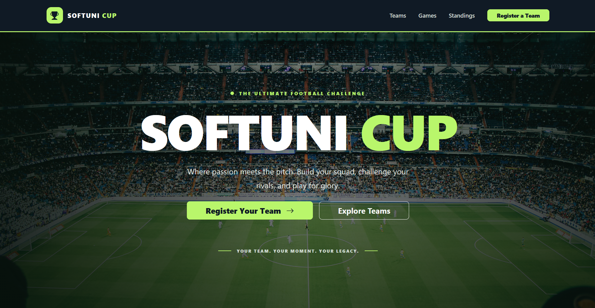
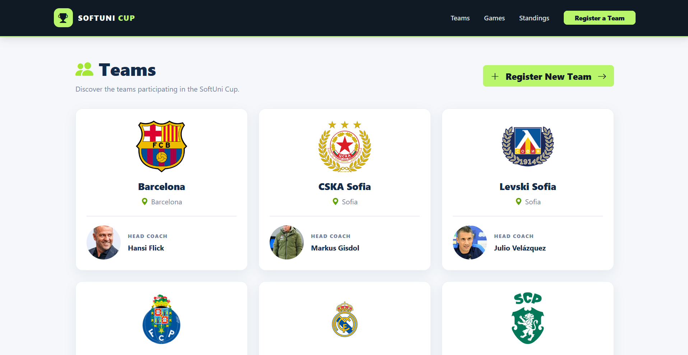
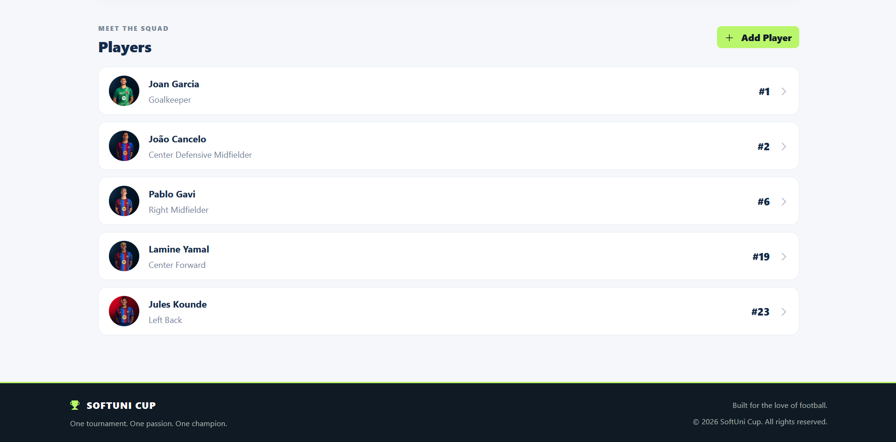
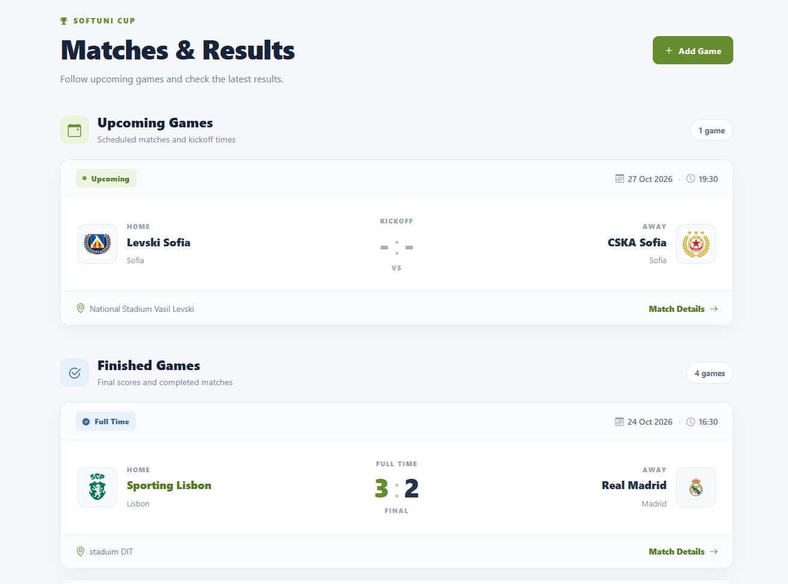
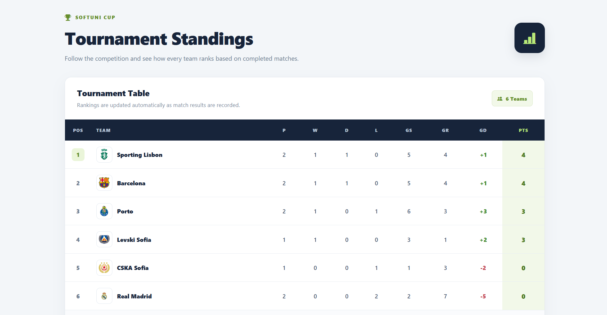

# ⚽ SoftUni Cup

**SoftUni Cup** is a football tournament management web application developed using Python and Django.

Built for the love of football.

The application allows users to manage football teams, players, and matches, track results, and view tournament standings.

## About the Project

The goal of SoftUni Cup is to provide a simple and intuitive way to organize a football tournament. Users can register teams and players, schedule matches, record results, and follow team performance through an automatically calculated standings table.

---
## Installation

**1. Clone the repository**

```bash
git clone https://github.com/Alisa2231/SoftUniCup.git
cd SoftUniCup
```

**2. Create and activate a virtual environment**

```bash
python -m venv .venv
```

Windows:

```bash
.venv\Scripts\activate
```

macOS/Linux:

```bash
source .venv/bin/activate
```

**3. Install dependencies**

```bash
pip install -r requirements.txt
```

**4. Apply database migrations**

```bash
python manage.py migrate
```

**5. Run the development server**

```bash
python manage.py runserver
```

Open **http://127.0.0.1:8000/** in your browser.

### Environment Variables and Credentials

No environment variables, API keys, external service credentials, or preconfigured accounts are required for local testing. The application uses SQLite.

---

## Features

- **Teams:** Create, view, edit, and delete football teams.
- **Players:** Register and manage players associated with teams.
- **Matches:** Schedule games, view match details, update match information, record final scores, and correct results.
- **Standings:** Automatically calculate team rankings based on completed matches, points, and goal difference.
- **User Interface:** Responsive design with consistent navigation, custom styling, and a custom 404 error page.

## Technologies Used

- Python
- Django
- SQLite
- HTML
- CSS
- Bootstrap 5

---

## Usage

After launching the application:

1. Start by registering the teams in the tournament from the home page buttons or via the **Teams** page. This will create a personalized page for each team listing all the players in the team and all games of the team - both upcoming and finished.
2. Add **Players** to each team from the team's page.
3. Schedule matches between teams in **Games**.
4. Finish matches by entering their final scores.
5. Open **Standings** to see the automatically updated rankings.

All data can be created through the application's interface. No initial database records or administrator access are required.

---
## Testing

To test the application, start with a fresh database after applying migrations, then use the navigation menu to create teams, players, and games.

Verify that create, view, edit, and delete operations work correctly, that form validation handles invalid input, and that completed games update the standings.

The application does not require preloaded sample data.

---
## Author and Credits

Developed by **Asya Nikolova**, a proud football mom, as a Django Basics course project at **SoftUni**.

## License

This project was created for educational purposes.

---

## Screenshots
  








